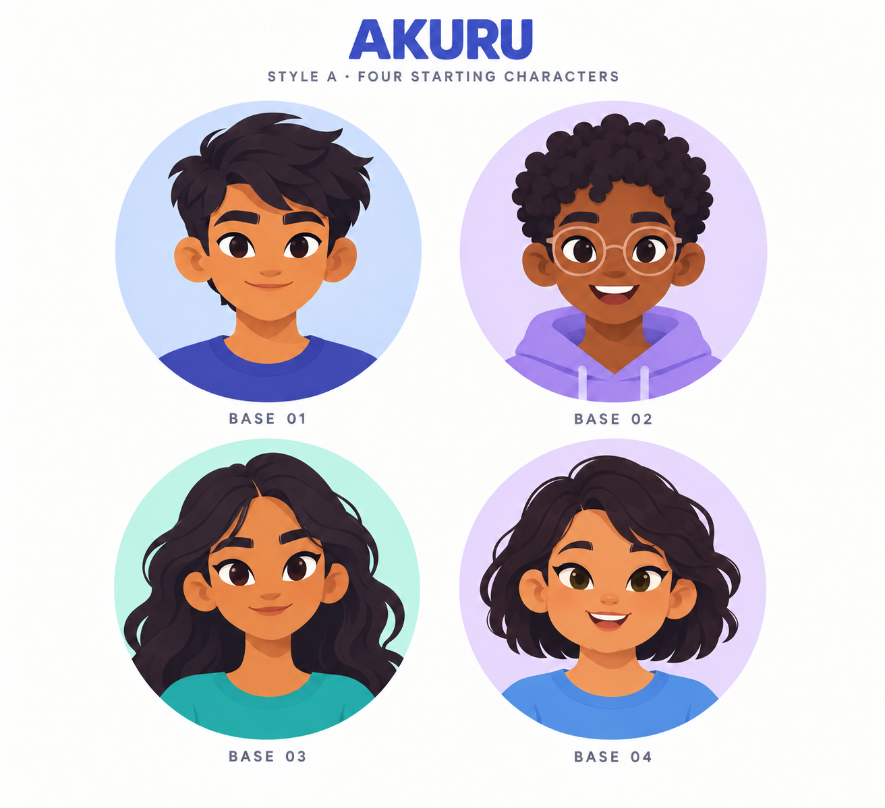

# AKURU Style A — four starting characters

Created 19 October 2026 with the built-in image-generation tool, using column A of the earlier AKURU style board as a style reference.

Revision 2 changes Base 04 to a wider, rounder face, different brows, a button nose, open smile and short softly curled hair. Bases 01–03 are retained. The original v1 concept sheet is preserved.

- Base 01: boy, side-swept hair, indigo top.
- Base 02: boy, natural curls, round glasses, lavender hoodie.
- Base 03: girl, long wavy hair, teal top.
- Base 04: girl, fuller rounded face, short softly curled hair, hazel eyes, open smile, blue top.

These are editable starting combinations in the planned builder, not locked character categories. All supported customisation options will remain available for every base.

This PNG is a visual concept sheet. It has not been installed as an avatar feature, and its hair, eyes, glasses and clothing are not yet independent production layers. Next: review the four designs, then construct and align the modular vector catalogue and connect the editor/persistence.

## Generation prompt

Use case: stylized-concept. Asset type: four original AKURU student avatar base-character concept designs, one clean 2-by-2 comparison sheet. Reference image: the provided AKURU comparison board is a STYLE REFERENCE ONLY. Use exclusively column A, 'Soft geometry'; ignore the B and C columns. Preserve A's gentle rounded geometric cartoon language, friendly simplified almond/oval eyes with visible iris colour, separately shaped eyebrows, tiny stylised nose, compact smiling mouths, smooth crisp hair masses and restrained flat tonal shading. Create FOUR original cartoon HUMAN teenagers: TWO BOYS on the top row and TWO GIRLS on the bottom row. Not photorealistic and not 3D. Appropriate for a secondary-school learning app. All four portraits must be STRAIGHT FRONT-FACING, eyes looking at viewer, same centred head position, same eye baseline, same head size, same neck attachment and same head-and-shoulders crop, for future modular hairstyle/glasses/clothing customisation. Identity differences are DEFAULT feature combinations, not rigid locked character categories. Top-left Base 01: warm tan skin, short dark side-swept hair, dark brown eyes, plain indigo crew-neck top, relaxed closed-mouth smile, boy. Top-right Base 02: deep brown skin, short natural dark curls, warm brown eyes, simple round translucent-rim glasses, plain lavender hoodie, gentle open smile, boy. Bottom-left Base 03: medium warm brown skin, long dark wavy hair, brown eyes, plain teal crew-neck top, gentle confident smile, girl. Bottom-right Base 04: light-medium warm skin, neat chin-length dark bob with a subtle side part, hazel eyes, plain soft blue crew-neck top, friendly smile, girl. Keep proportions and rendering coherent across all four. Circular pale blue/lilac/mint/lavender portrait backdrops, warm white overall background, generous whitespace. Large clear portraits, no extra characters or objects. Elegant small top title exactly 'AKURU' with subtitle exactly 'STYLE A · FOUR STARTING CHARACTERS'. Under each portrait only the small labels 'BASE 01', 'BASE 02', 'BASE 03', 'BASE 04', respectively. No other text. This is an art concept sheet, not an app screenshot or a completed interactive editor. Crisp clean vector-like 2D cartoon artwork at high quality; no detailed skin textures, no realistic anatomy, no tiny ornamental details, no jewellery. Original AKURU facial construction and silhouettes, not existing licensed characters, no Duolingo characters or owl mascots, no robots, no watermark.

